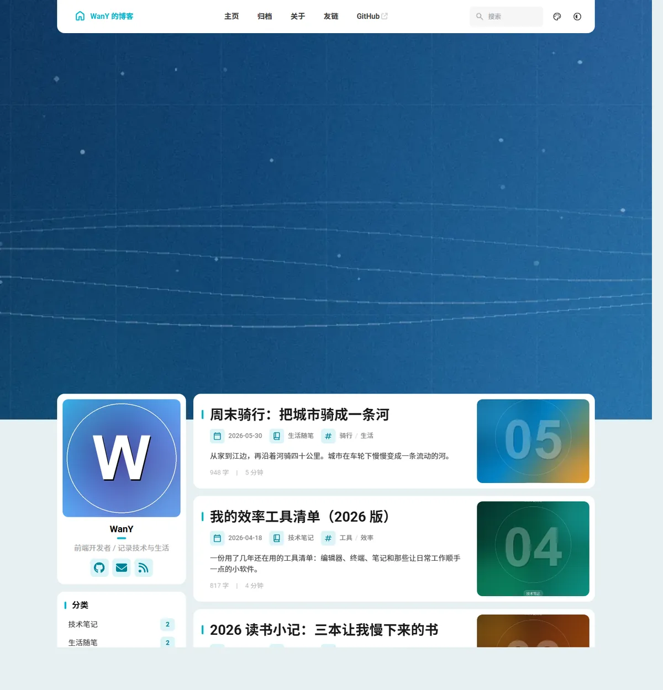
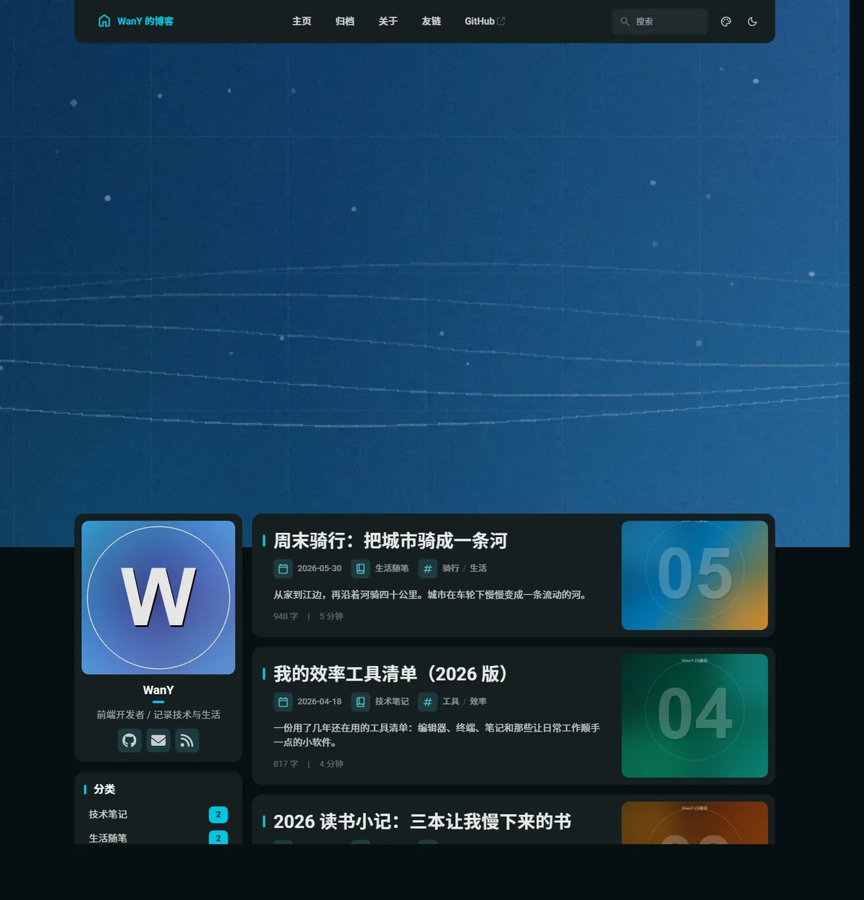
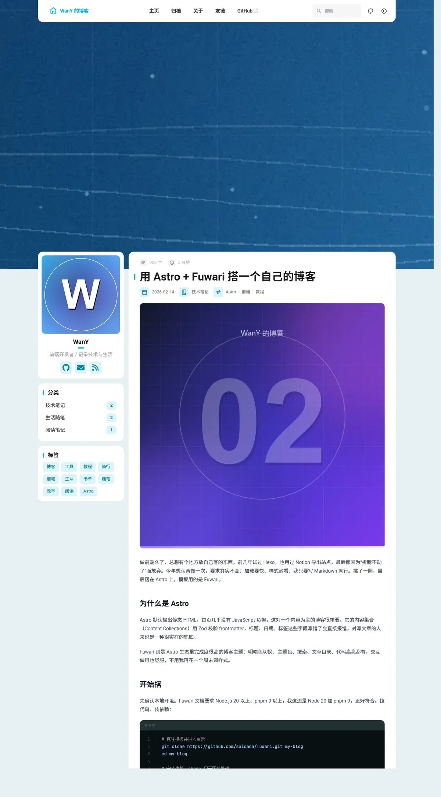
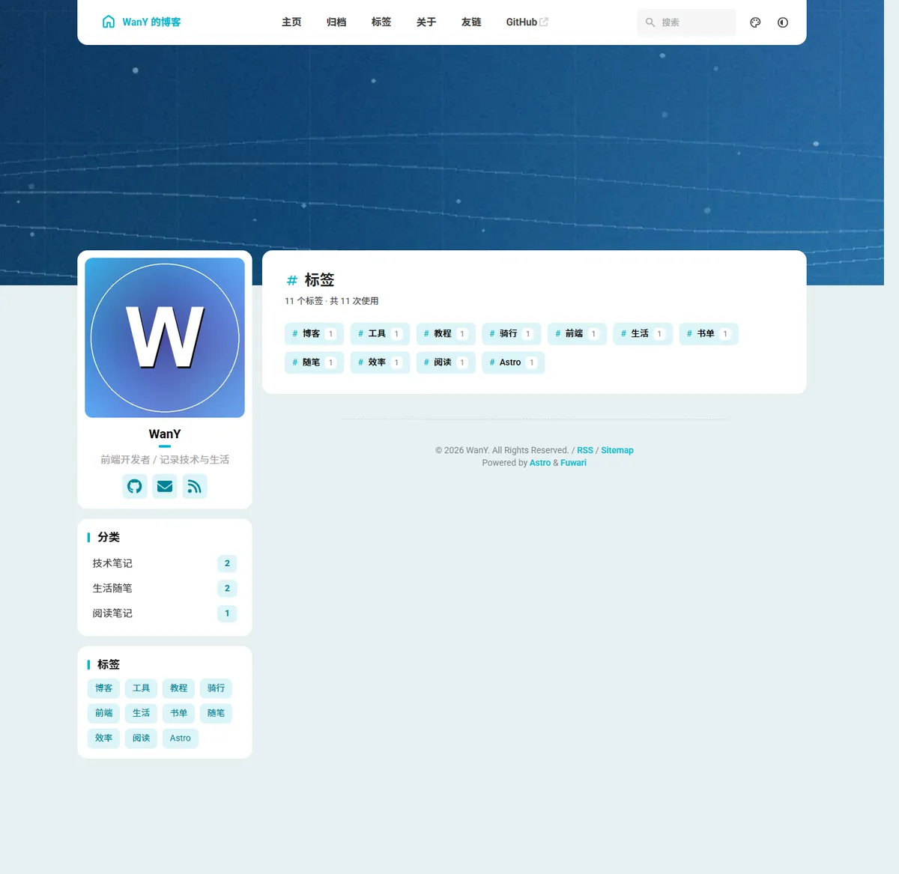
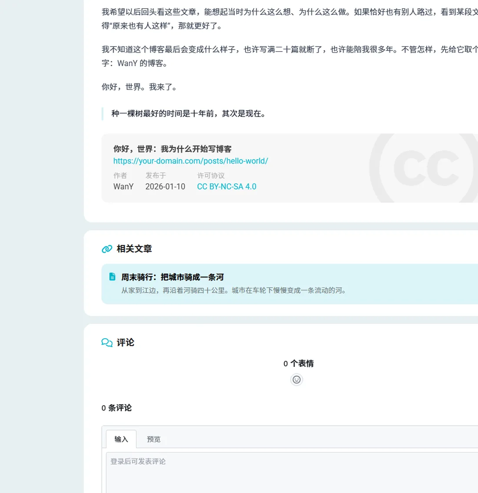

# WanY 的博客

一个基于 [Astro 5](https://astro.build) + [Fuwari](https://github.com/saicaca/fuwari) 二次开发的个人博客。静态输出、加载快，支持中文、全文搜索、明暗模式与 RSS。

> 本仓库是在 Fuwari 模板（MIT 协议）基础上修改而来的。原始模板：<https://github.com/saicaca/fuwari>

## 📸 预览

| 首页（亮色） | 首页（暗色） |
|:---:|:---:|
|  |  |

| 文章页 | 友链页 |
|:---:|:---:|
|  |  |

| 移动端首页（小屏隐藏 Banner） | 标签页 |
|:---:|:---:|
|  |  |

| 文章底部：相关文章 + 评论区 |
|:---:|
|  |

## ✨ 功能

- **Astro 静态构建**：输出纯静态 HTML，交互组件按需水合，首屏几乎没有 JS 负担
- **中文站点**：界面文案、站点语言（`zh_CN`）、RSS/日期等均已本地化
- **明暗模式 + 可调主题色**：默认色调 `hue: 210`，访客可自行切换主题色
- **全文搜索**：[Pagefind](https://pagefind.app) 静态索引，中文可搜
- **文章体系**：标签聚合页（`/tags/`）、分类、归档、分页、目录（TOC）、阅读时长、相关文章、置顶、上一篇/下一篇
- **Markdown 扩展**：`:::tip` 等提示框、GitHub 仓库卡片、KaTeX 数学公式、Expressive Code 代码块
- **个性化**：自制横幅/头像/文章封面、友链页、404 页面、自定义 favicon
- **评论与统计**：Giscus 评论已启用（数据存 `WanY15/blog-comments` 的 Discussions）；访问统计支持 Umami / Cloudflare / Google，可通过 `config.ts` 或 `PUBLIC_*` 环境变量接入（默认关闭）
- **SEO**：`sitemap`、`robots.txt`、`rss.xml`、canonical、Open Graph / Twitter 分享图（每篇文章自动使用封面）、JSON-LD 结构化数据（WebSite + BlogPosting）
- **移动端优化**：小屏自动隐藏 Banner，让文章内容优先展示

## 🚀 本地运行

环境要求：**Node.js >= 20**、**pnpm >= 9**（推荐 pnpm）。

```bash
# 安装依赖
pnpm install

# 本地开发（默认 http://localhost:4321）
pnpm dev

# 生产构建，产物在 dist/
pnpm build

# 预览构建产物
pnpm preview
```

> 💡 如果 `pnpm install` 因 `sharp` / `esbuild` 等依赖的安装脚本被拦截而失败，可以执行 `pnpm approve-builds` 后重试；若当前环境不允许子进程管道，可用 `pnpm install --ignore-scripts` 安装（本项目用到的二进制均已随可选依赖下发，可正常构建）。

## 📁 目录结构

```text
personal-blog/
├── src/
│   ├── config.ts              # 站点/导航/个人资料/评论/统计配置（最常改这里）
│   ├── content/
│   │   ├── posts/             # 文章（Markdown）
│   │   └── spec/about.md      # 关于页内容
│   ├── assets/images/         # 头像、横幅（会被 Astro 优化）
│   ├── pages/                 # 页面路由（含自建的 links.astro、404.astro、tags/）
│   ├── components/            # 组件（含自建的 Comments、Analytics、RelatedPosts、PostList）
│   ├── i18n/                  # 多语言文案
│   └── styles/                # 样式
├── public/
│   ├── covers/                # 文章封面图（WebP）
│   ├── favicon/               # 站点图标
│   └── og-default.webp        # 默认社交分享图（1200×630）
├── docs/
│   ├── deploy.md              # 部署指南（Cloudflare / Vercel / Netlify / GitHub Pages / 自建）
│   ├── customize.md           # 个性化与占位替换指南
│   └── screenshots/           # README 预览截图
├── astro.config.mjs           # Astro 配置（部署前改 site 域名）
├── .env.example               # 评论 / 统计环境变量示例
└── package.json
```

## ✏️ 改成你自己的

> 所有占位内容的替换索引（文件 + 具体字段）见 **[docs/customize.md](docs/customize.md)**，下面是最常用的几项。

1. **站点信息**：编辑 `src/config.ts`
   - `siteConfig`：标题、副标题、语言、主题色、横幅、TOC、favicon、默认分享图
   - `navBarConfig`：导航栏（首页 / 归档 / 关于 / 友链 / GitHub）
   - `profileConfig`：头像、昵称、简介、社交链接
   - `licenseConfig`：文末版权协议
   - `commentsConfig` / `analyticsConfig`：评论与统计（见下面第 7、8 条）
2. **部署域名**：`astro.config.mjs` 里的 `site`（影响 sitemap / RSS 的绝对链接）
3. **写文章**：在 `src/content/posts/` 新建 `.md`，或执行 `pnpm new-post <文件名>`。frontmatter 格式：

   ```yaml
   ---
   title: 文章标题
   published: 2026-01-01
   description: 一句话摘要
   image: /covers/cover.webp   # 文章封面
   tags: [标签1, 标签2]
   category: 分类名
   draft: false
   pinned: false               # true = 首页置顶
   ---
   ```

4. **关于页**：`src/content/spec/about.md`
5. **友链页**：`src/pages/links.astro` 顶部的 `friends` 数组
6. **图片资产**：
   - 头像 `src/assets/images/avatar.png`、横幅 `src/assets/images/banner.png`
   - 文章封面放在 `public/covers/`，建议用 WebP 控制体积（文章页/Giscus 不会压缩大图）
   - favicon 在 `public/favicon/`，当前使用的是 `avatar-32.png` / `avatar-192.png`
7. **评论（Giscus）**：**已启用**，当前使用 `WanY15/blog-comments` 仓库的 `General` 分类；需要更换仓库时编辑 `src/config.ts` 的 `commentsConfig`，或用 `.env` 里的 `PUBLIC_GISCUS_*` 覆盖（详见 [docs/customize.md](docs/customize.md)）
   - 前提：存放评论的仓库必须**公开**并开启 Discussions、安装 [giscus App](https://github.com/apps/giscus)
   - 到 <https://giscus.app/zh-CN> 可获取新的 `repoId` / `categoryId`
8. **访问统计**：编辑 `src/config.ts` 的 `analyticsConfig`，或使用 `PUBLIC_ANALYTICS_PROVIDER` 等环境变量（见 `.env.example`）
   - `provider` 可选 `"none"` / `"umami"` / `"cloudflare"` / `"google"`，填好对应 ID 即自动注入脚本
9. **社交分享图**：`public/og-default.webp`（1200×630）；文章页会优先使用文章封面作为分享图

## 🌐 部署

详细的图文步骤见 **[docs/deploy.md](docs/deploy.md)**，覆盖 Cloudflare Pages、Vercel、Netlify、GitHub Pages 与自建服务器。

构建命令 `pnpm build`，输出目录 `dist/`。简单说：

- **Vercel / Netlify / Cloudflare Pages**：导入仓库，框架选 Astro，构建命令 `pnpm build`，输出目录 `dist`
- **GitHub Pages**：注意 `site` + `base` 的配置（否则静态资源路径会错），详见部署文档
- **自建服务器**：`dist/` 是纯静态文件，交给 Nginx/Caddy 即可

仓库自带两个 GitHub Actions：`build.yml`（push/PR 自动构建 + `astro check`）和 `deploy.yml`（手动部署到 Cloudflare Pages，需配置 Secrets）。

## 🚦 上线检查清单

- [ ] 把 `astro.config.mjs` 的 `site` 改成正式域名（RSS / sitemap / OG 绝对链接都依赖它）
- [ ] 替换个人信息：昵称、简介、头像、GitHub、邮箱（`src/config.ts` 与 `src/content/spec/about.md`）
- [ ] 用真实文章替换示例文章，删除文中的“占位”说明
- [ ] 需要评论/统计时填好 `commentsConfig` / `analyticsConfig`
- [ ] 部署后检查：RSS、sitemap、404、搜索、分享卡片（OG）、移动端首屏
- [ ] 提交到 Google Search Console / Bing Webmaster / 百度搜索资源平台

## 🛠 二次开发记录

相对原版 Fuwari 的主要改动：

- 中文化：站点语言 `zh_CN`、中文导航/界面文案、全中文示例内容
- 品牌化：站点名、个人资料、主题色（hue 210）、自制头像/横幅/5 张文章封面、favicon
- 内容替换：删除模板英文 demo 文章，新增 5 篇中文示例文章并重写关于页
- 新增页面：`/links/`（友链）与 `404` 页面，导航栏加入友链入口
- 工程化调整：`.npmrc` 关闭 pnpm 自动切换版本；移除仅允许 pnpm 的 `preinstall` 钩子；`package.json` 更名为 `wany-blog`
- 部署配置：`astro.config.mjs` 的 `site` 改为占位域名，部署前需替换
- 第二轮改进：接入可配置的 Giscus 评论与访问统计（默认关闭）；补齐 `og:image`、canonical、WebSite/BlogPosting JSON-LD；移动端隐藏 Banner 让内容优先；新增移动端导航与页面截图；补充部署文档、CI（Node 20/22）与手动部署工作流；初始化 Git 仓库
- 第三轮改进：新增 `/tags/` 标签聚合页与标签文章页（导航加入「标签」）；文章详情页新增「相关文章」（按标签/分类评分）；支持文章置顶（`pinned: true`，首页优先展示并带置顶标识）；评论/统计支持 `PUBLIC_*` 环境变量接入；补齐 `.env.example` 与 [docs/customize.md](docs/customize.md) 替换索引
- 第四轮改进：启用 Giscus 评论（`WanY15/blog-comments` → `General` 分类），评论主题跟随站点明暗模式

## 📄 许可与致谢

- 博客主题：[Fuwari](https://github.com/saicaca/fuwari)，MIT License
- 静态站点框架：[Astro](https://astro.build)，MIT License
- 本站文章内容（除特别说明外）采用 [CC BY-NC-SA 4.0](https://creativecommons.org/licenses/by-nc-sa/4.0/) 许可协议
- 当前 5 篇示例文章为演示内容，其中的链接与个人信息为占位，后续可自行替换
